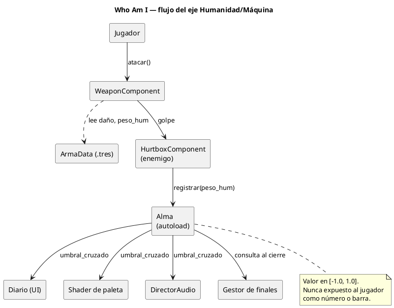
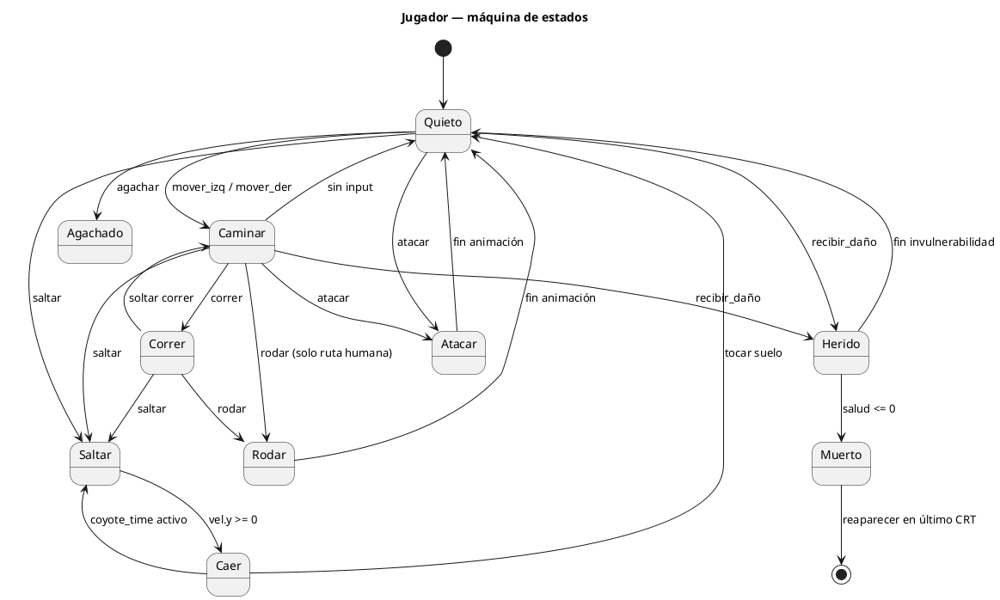
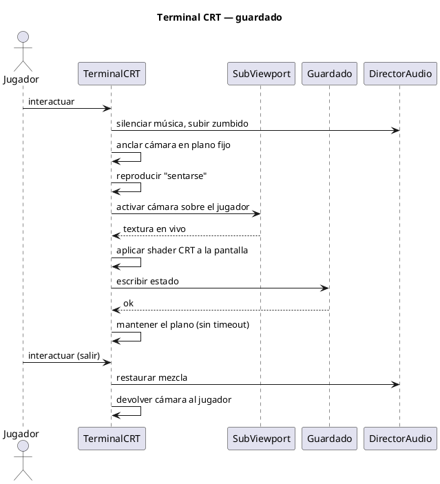

# Arquitectura — Who Am I

## 1. Estructura de carpetas

```
res://
├── autoload/
│   ├── alma.gd              # eje humanidad↔máquina
│   ├── estado_juego.gd      # progreso, misiones, flags narrativos
│   ├── guardado.gd          # serialización a user://
│   ├── director_audio.gd    # buses, crossfade, capas del ambient
│   └── cargador_escenas.gd  # transiciones con fundido
├── actors/
│   ├── player/
│   │   ├── jugador.tscn
│   │   ├── jugador.gd
│   │   └── estados/         # un script por estado
│   ├── enemies/
│   └── bosses/
├── systems/
│   ├── components/          # salud, hitbox, hurtbox, arma
│   ├── weapons/
│   │   ├── arma_data.gd
│   │   └── data/*.tres
│   └── save_points/         # terminal CRT + SubViewport
├── ui/
│   ├── diario/              # menú de pausa diegético
│   └── hud/
├── levels/
│   ├── nivel_01/
│   └── plantillas/
├── art/
│   ├── placeholder/
│   ├── final/
│   └── PLACEHOLDERS.md      # tabla de assets pendientes
├── audio/
├── shaders/                 # paleta, CRT, glitch, agua/niebla
└── tests/                   # GUT
```

## 2. Autoloads

| Autoload | Responsabilidad | No debe hacer |
|---|---|---|
| `Alma` | Guardar y modificar el eje; emitir `umbral_cruzado` | Tocar UI ni escenas |
| `EstadoJuego` | Flags narrativos, misiones, armas obtenidas | Lógica de combate |
| `Guardado` | Leer/escribir `user://`, versionado | Decidir cuándo guardar |
| `DirectorAudio` | Buses, capas del ambient según el eje | Reproducir SFX de entidades |
| `CargadorEscenas` | Cambios de escena con fundido y precarga | Guardar progreso |

Regla: los autoloads **no se conocen entre sí** salvo por señales. `Guardado`
consulta a `Alma` y `EstadoJuego` al serializar, y nada más.

## 3. Diagramas

### 3.1 Componentes y flujo del eje



### 3.2 Máquina de estados del jugador



### 3.3 Secuencia del punto de guardado (TV Buddha)



## 4. Feel del movimiento (no negociable)

Un plataformero se juzga en los primeros 30 segundos. Implementar desde el Hito 1:

- **Coyote time**: ~0.1 s de gracia para saltar tras dejar el suelo.
- **Jump buffer**: ~0.12 s, el salto pulsado justo antes de aterrizar se ejecuta.
- **Altura variable**: soltar el botón corta el ascenso.
- **Gravedad asimétrica**: caída más rápida que subida (×1.6 aprox).
- **Corner correction**: empujar al jugador si el salto roza una esquina por 1–2 px.
- Todos esos valores como `@export` en el script del jugador, para tunearlos en
  el inspector sin recompilar mentalmente nada.

## 5. Guardado — formato

```json
{
  "save_version": 1,
  "fecha": "2026-08-26T14:03:00",
  "checkpoint_id": "nivel_01_crt_02",
  "alma": -0.18,
  "salud": 6,
  "vendas": 2,
  "armas": ["tubo_metal", "pistola_reciclada"],
  "arma_equipada": "tubo_metal",
  "flags": { "diario_obtenido": true, "jefe_01_derrotado": false },
  "estadisticas": { "muertes": 12, "enemigos_evitados": 7, "tiempo_seg": 1840 }
}
```

Siempre validar `save_version` al cargar y migrar o rechazar con mensaje claro.
